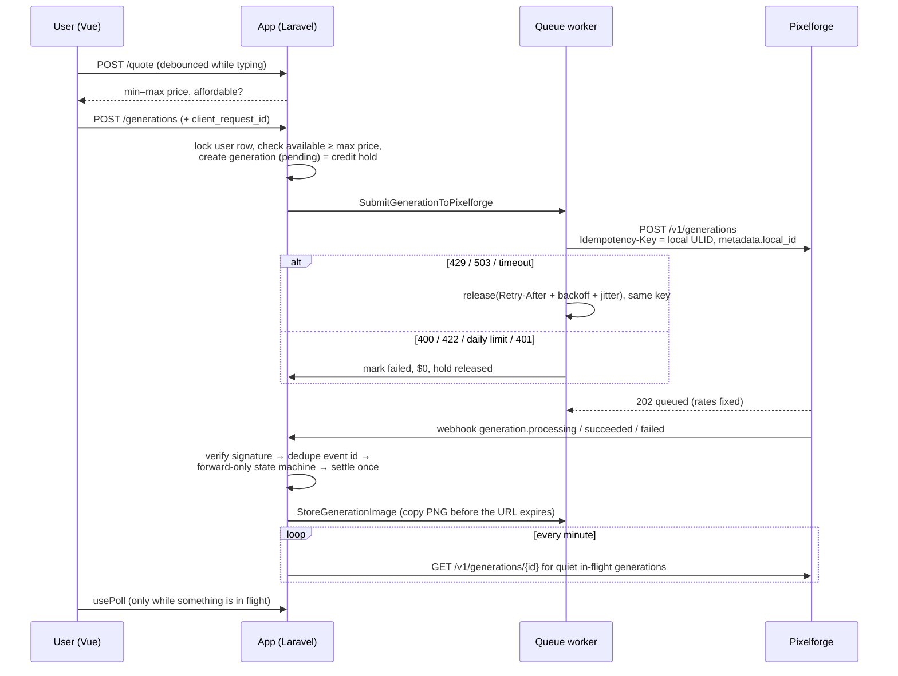

# Pixelforge Studio

A Laravel 13 + Vue 3 + Inertia 3 app where signed-in users generate images through **Pixelforge**, a simulated AI image provider that works asynchronously, charges per token and sometimes fails. Users see the price range before submitting. They pay Pixelforge's cost plus 25%, are charged exactly once, and pay nothing for failed generations.

Both stretch goals are included: **credit balances** with fake purchases, and an **admin report** that compares our provider costs with Pixelforge's `GET /v1/usage`.

| | |
|---|---|
| Stack | Laravel 13.43, PHP 8.4, Inertia 3 (Vue 3.5 + TypeScript), Tailwind 4, Wayfinder, Fortify; MySQL in production, Postgres locally (tests run on both) |
| Quality | Pest (106 tests), PHPStan/Larastan level 7, Pint, vue-tsc, Vite+ lint/format; GitHub Actions matrix on MySQL + Postgres |

---

## How a generation flows



## Money

**Integer nanodollars, never floats.** Pixelforge reports exact decimals with nine places, so every amount is stored as `BIGINT` nanodollars (1e-9 USD). This happens in the `App\Support\Money\Usd` value object, which also serves as the Eloquent cast. Decimal strings are parsed with `brick/math`, and parsing throws instead of losing precision. The frontend receives decimal strings and formats them with `BigInt` (`resources/js/lib/money.ts`).

**One place computes prices.** `CostCalculator` computes `Σ tokens × rate ÷ 1M` from the rates stored on that generation, which Pixelforge fixes at creation, never from today's pricing. The user's charge is that cost × 1.25. `CostEstimator` uses the same calculator for quotes, and the test suite reproduces the docs' worked example exactly (`$0.373875000`).

**Fractions of a cent (the brief leaves this open).** Charges are exact to the nanodollar. The 25% markup can produce sub-nanodollar remainders (e.g. 1 nano × 1.25). Those are rounded **up**, so we never under-charge, and the most it can add is $0.000000001 per generation. Users see 4 decimals; hovering a price shows all 9.

**Estimate = authorization hold, settle = actual.** The pre-submit price is a range: text tokens are ±15% and reasoning tokens vary by quality. While a generation is in flight, its **maximum** possible charge is held against the user's balance:

```
available = balance − Σ max charge of in-flight generations
```

On success we charge the actual cost, which is always within the range. On failure we charge $0. Either way the hold disappears because the generation is no longer in flight. Holds are derived, not stored, so they can't drift. Spending is serialised per user with `SELECT … FOR UPDATE`, so two tabs can't spend the same credit.

**Ledger.** Every balance change is a row in `credit_transactions` with the resulting balance. `UNIQUE(generation_id, type)` makes a second charge for the same generation impossible at the database level.

## Robustness: the edge cases handled

| Situation | Handling |
|---|---|
| Webhook delivered twice | `webhook_events.event_id` is unique (`createOrFirst`), so a processed event returns 204 immediately |
| Same state reported by different paths (webhook + submit response + poll) | `SyncGenerationFromProvider` locks the row; a generation only moves forward, and a final state is settled once |
| Out-of-order events (`processing` after `succeeded`) | Status has a rank; lower or equal ranks are ignored, and `succeeded`/`failed` are never left |
| Webhook arrives before `POST /generations` returned | We send `metadata.local_id`; the webhook finds the generation by provider id **or** local id |
| Webhooks lost entirely | `generations:reconcile` (every minute) polls in-flight generations quiet for >90s |
| `429 rate_limit` / `429 concurrency_limit` / `503 overloaded` / network timeout | Job is released for `Retry-After` + exponential backoff + jitter, **with the same Idempotency-Key**, so no duplicate is ever created or billed. UI shows "Waiting for a free slot…" |
| Retries never succeed | Job gives up after 15 minutes (time-based, because waits are releases, not errors). The generation is marked failed at $0 |
| …but Pixelforge did accept one of those attempts | Its webhook still matches by `local_id`. We record the provider cost (so `/v1/usage` reconciles) but keep our promise not to charge |
| `400 content_policy` / `422` / `429 daily_limit` / `401` / `409 idempotency_key_reused` | Terminal: failed with a human-readable message, $0, hold released. 401/409 are logged as critical (they mean we have a bug or a misconfiguration) |
| Generation fails after acceptance (`generation_failed`, `internal_error`) | $0. A **Retry** button creates a new generation; a deterministic request id stops a double-click from creating two |
| Queue job lost (worker crash, deploy) | Reconciler re-queues `pending` generations that have gone quiet; submission is idempotent |
| Double-clicked submit | The form sends a `client_request_id` (unique per user), so the same request yields the same generation |
| Invalid / stale / replayed webhook | HMAC-SHA256 over the raw body, `hash_equals`, 300s tolerance, multiple `v1` values supported. Bad requests get 400; the route is outside the `web` group, so there is no CSRF |
| Image URLs expire after 24h | `StoreGenerationImage` copies the PNG to our disk (S3/R2 bucket in production). The UI falls back to Pixelforge's URL, then to an "expired" state, and `` is handled |
| Pricing API down | Stale-while-revalidate cache (`Cache::flexible`) plus a last-known-good copy. With neither, generation is paused with a clear message |
| Unicode prompts | Characters are counted as code points (`mb_strlen` / `[...str].length`), matching Pixelforge, not bytes or UTF-16 units |
| Validation | Mirrors Pixelforge: prompt ≤ 4000 chars, size/quality enums, ≤ 4 distinct http(s) reference URLs. Empty rows are ignored |
| Account deleted | `user_id` is set to null on delete, so money records survive for reporting |

## Admin report (stretch goal)

`/admin/report` (users with `is_admin`) shows, per **UTC day of completion** (Pixelforge bills on the day a generation *completes*) and per user: credit spend, provider cost and profit. Each day is compared with `GET /v1/usage` for this environment's API key: ✓ when cost and count match to the nanodollar, ⚠ otherwise. The range is capped at Pixelforge's 92 days, and the report still renders if the usage API is down.

## Running locally

```bash
composer install && npm install
cp .env.example .env && php artisan key:generate
# Postgres (or MySQL — set DB_* in .env): createdb larajob && createdb larajob_test
php artisan migrate --seed            # admin@example.com / password (local only)
php artisan storage:link
composer run dev                      # app + queue worker + vite
php artisan schedule:work             # reconciler
```

Pixelforge setup: create an API key **per environment** and set `PIXELFORGE_API_KEY` and `PIXELFORGE_WEBHOOK_SECRET`. Webhook URL: `https://<public-host>/api/webhooks/pixelforge`. For local development, expose the app with ngrok, Expose or Cloudflare Tunnel.

Testing keywords in prompts: `[fail]`, `[slow]`, `[duplicate]`, `[blocked]`, `[overloaded]`, `[succeed]`.

```bash
composer ci:check   # lint, types (vue-tsc, PHPStan L7), Pint, Pest
```

## Deployment (Laravel Cloud)

- MySQL database attached to the environment (`DB_*` is injected).
- A **background process** on the app cluster: `php artisan queue:work --sleep=1 --timeout=60`. Without it, generations stay in "Submitting", because nothing sends them to Pixelforge.
- The **scheduler** enabled on the app cluster (runs `generations:reconcile` every minute).
- A **public** object storage bucket attached with the disk name `public`. Images are copied there; the server filesystem is ephemeral.
- Env: `PIXELFORGE_API_KEY`, `PIXELFORGE_WEBHOOK_SECRET` (the production key, separate from local), `SEED_ADMIN_EMAIL`, `SEED_ADMIN_PASSWORD`.
- Deploy commands: `php artisan migrate --force` and, on first deploy, `php artisan db:seed --force`.

## Code map

| Concern | Where |
|---|---|
| Money | `app/Support/Money/Usd.php`, `UsdCast.php` |
| Pricing, estimates, ledger | `app/Services/Billing/*` |
| Pixelforge HTTP client, DTOs, errors | `app/Services/Pixelforge/*` |
| Create → submit → sync (state machine) | `app/Actions/Generations/*`, `app/Jobs/*` |
| Webhooks | `app/Http/Middleware/VerifyPixelforgeSignature.php`, `app/Http/Controllers/PixelforgeWebhookController.php` |
| Reconciler | `app/Console/Commands/ReconcileGenerations.php` (scheduled in `routes/console.php`) |
| Admin report | `app/Services/Reporting/ProfitReport.php` |
| UI | `resources/js/pages/{generations,credits,admin}`, `resources/js/components/Generation*.vue` |

## Trade-offs and what I'd do next

- **Polling vs websockets:** Inertia `usePoll` with partial reloads, running only while something is in flight. It needs no extra infrastructure and works through flaky connections. Reverb would be the next step at scale.
- **Webhook work in-request:** the state transition is a few milliseconds of DB work, so it runs before we answer. If it fails we return 5xx and Pixelforge retries. Slow work (the image download) is queued.
- **If rates rose between quote and creation**, the actual charge could exceed the hold by that difference. The balance could dip slightly below zero, but the charge is still exact. A follow-up would re-estimate the hold from the accepted generation's rates.
- Next: per-user concurrency caps, pruning old `webhook_events` rows, structured metrics on retry and backoff rates.
